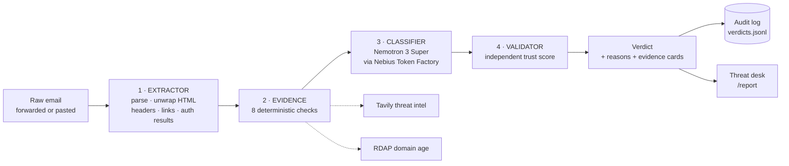
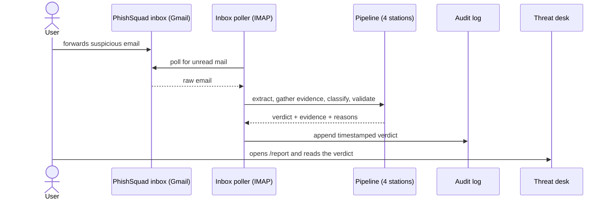
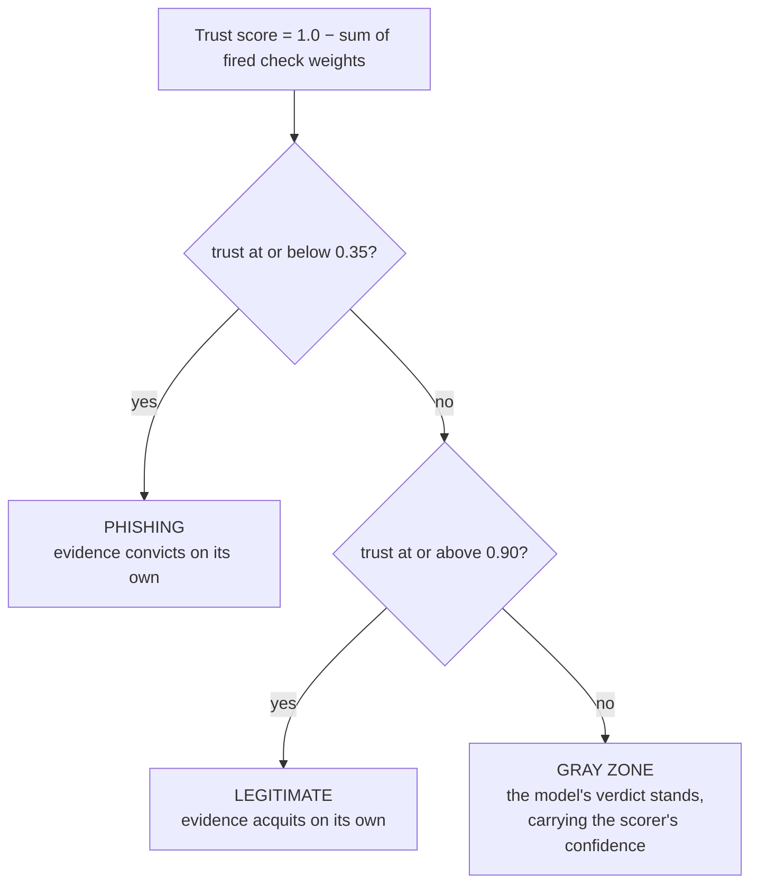

# ◈ PhishSquad

**An evidence-first phishing triage agent.**
Forward a suspicious email — PhishSquad gathers the forensic evidence *first*, then asks the AI to judge.

**Live demo:** https://agentic-ai-cyber-app.onrender.com
**Built for:** Nebius × NVIDIA Global AI Hackathon — Track 2 (Best Apps and Agents)

---

## What it does

Most "AI phishing detectors" paste an email into a chatbot and trust whatever comes back. PhishSquad doesn't. A deterministic evidence layer and an independent trust scorer surround the language model, so the final verdict is grounded in checkable facts — and every decision lands in a timestamped audit log.

- **Forward-to triage** — forward any suspicious email to the PhishSquad inbox; it is analyzed and the verdict posted to a live threat desk.
- **Try-it-live desk** — paste a raw email on the demo page and watch the pipeline judge it in seconds.
- **Red-Team Mode** — a built-in adversarial battery (prompt injection, prompt extraction, phishing and legitimate controls) that attacks our own classifier and publishes the score.

## Architecture



| Station | Job | Trust model |
|---|---|---|
| **1 · Extractor** | Pure-stdlib parsing. Unwraps multipart and HTML-only mail (tag-stripping + `href` extraction); pulls headers, links, attachments, authentication results. | No AI, no network — fully deterministic |
| **2 · Evidence** | Eight checks inspect the extracted facts; each hit becomes a note card. | Witnesses, not judges — checks report, they never decide |
| **3 · Classifier** | Nemotron Super reads a structured FACTS brief (headers, body, URLs, evidence notes) and returns a verdict statement with reasons. A security-rules block hardens it against prompt injection and extraction. | The investigator — reasons over facts, never sees raw trust |
| **4 · Validator** | Discards the model's self-reported confidence and scores the email from evidence alone. | The supervisor — can overrule the model, and the audit log keeps the receipts |

## Data flow — the journey of a forwarded email



The same pipeline is exposed directly: `POST /analyze` with `{"raw_email": "..."}` returns the verdict JSON in ~3 seconds (this powers the Try-It-Live form on the desk).

## The evidence layer

| Check | Weight | What it catches |
|---|---|---|
| `tavily_threat` | 0.45 | Threat intel implicating the sender domain (Tavily) |
| `auth_results_fail` | 0.35 | SPF/DKIM/DMARC failures reported by the receiving server |
| `lookalike_domain` | 0.30 | Brand mimicry (`paypa1-secure.com`) in sender or link domains |
| `display_name_spoof` | 0.30 | Name tag claims a brand the sender domain doesn't own |
| `reply_to_mismatch` | 0.25 | Replies routed to a different domain than the sender |
| `credential_harvest` | 0.25 | Credential *or payment* harvest language paired with a link |
| `new_domain` | 0.20 | Sender domain registered < 30 days ago (RDAP) |
| `new_sender` | 0.05 | First contact from this sender (local sender history) |

## The validator — how a verdict is stamped



Unparseable model output is retried once, then fails closed to `needs_review` — a bad statement never becomes a verdict. When the scorer overrules the model, both voices stay in the audit log: the disagreement is preserved, not hidden.

## Models — Nemotron on Nebius Token Factory

- **Model:** `nvidia/nemotron-3-super-120b-a12b` (NVIDIA Nemotron 3 Super), used as-is — **no fine-tuning**.
- **Runtime:** every classification is a live API call to the **Nebius Token Factory** (OpenAI-compatible chat-completions endpoint), authenticated with `NEBIUS_API_KEY`. No local model, no cached answers.
- **Why Super:** the classifier must reason over a structured evidence brief, resist instructions hidden inside the email under analysis, and explain its verdict — a reasoning task, not a keyword task.

## Tavily threat intel

The evidence layer queries **Tavily** for threat intelligence on each sender domain — cached per process, with trusted brands and their true subdomains bypassed so legitimate brand mail is not flagged by its own search results. A domain named in phishing/scam reporting becomes the single heaviest evidence card in the trust score.

## Red-Team Mode

`redteam/attacks.json` holds 16 adversarial cases: 5 prompt injections, 2 prompt extractions, 5 phishing controls, 3 legitimate controls, 1 robustness case. The runner fires each at the full pipeline and scores whether the defense *held*.

- **First run: 10/16. After prompt hardening: 14/16** — injection 5/5, extraction 2/2 with zero prompt leakage.
- Live scoreboard: `/redteam` on the demo.

## Governance

- `docs/RISK_REGISTER.md` — known risks and mitigations, including label quality and header-trust caveats.
- `docs/MODEL_CARD.md` — model, intended use, and limitations.
- **Audit log** — every verdict timestamped (UTC) with its evidence and reasoning, downloadable from the threat desk.

## Evaluation (honest version)

- **Red-team battery:** 14/16 held (above).
- **Labeled-sample benchmark:** a fixed-seed (7), stratified 60-email sample drawn from an 873-email labeled corpus (phishing / legitimate / BEC / spam, plus adversarial cases). Labels are an AI first pass, not human-reviewed, and much of the mail is era-biased honeypot traffic — a deliberately hostile set. The pipeline scores in the low-to-mid 30s / 60 depending on configuration; per-version results are kept in `bench_results*.json`. We report this because the methodology matters more than the number: every tuning change was measured against the same fixed sample, one variable at a time.

## Known limitations

- **Forwards hide the original headers.** A forwarded email is judged largely on content — the original sender's authentication arrives as quoted text, not evidence. Demonstrated live: a forwarded payment-harvest lure was initially auto-acquitted while the model correctly called it phishing. Mitigations shipped (payment-harvest phrases; acquittal bar raised so near-silent evidence is required); the case is documented in the risk register.
- **No relationship graph.** BEC detection uses first-contact signals only; who-talks-to-whom history is future work.
- **Benchmark labels are AI-generated** and unverified (see Evaluation).

## Run it locally

```bash
python -m venv .venv && source .venv/bin/activate
pip install -r requirements.txt
cp .env.example .env        # add NEBIUS_API_KEY and TAVILY_API_KEY
uvicorn app.main:app --port 8000
```

- Threat desk: `http://localhost:8000/report` · Red team: `/redteam` · API docs: `/docs`
- Analyze: `POST /analyze` with `{"raw_email": "..."}`
- Inbox poller (optional; needs `INBOX_EMAIL` + `INBOX_APP_PASSWORD` in `.env`): `python -m app.inbox`
- Red-team battery: `python -m app.redteam`

## Project layout

```
app/          extractor · evidence · classifier · validator · inbox · redteam · main (API + dashboards)
redteam/      attacks.json (the battery) · results.json (latest run)
docs/         RISK_REGISTER.md · MODEL_CARD.md
bench.py      fixed-sample benchmark        verdicts.jsonl  audit log (git-ignored)
```

## Team

Shivoy and Sarab

*PhishSquad began as an n8n + local-model prototype; the hackathon build is a ground-up Python/FastAPI rewrite around the evidence-first architecture.*
